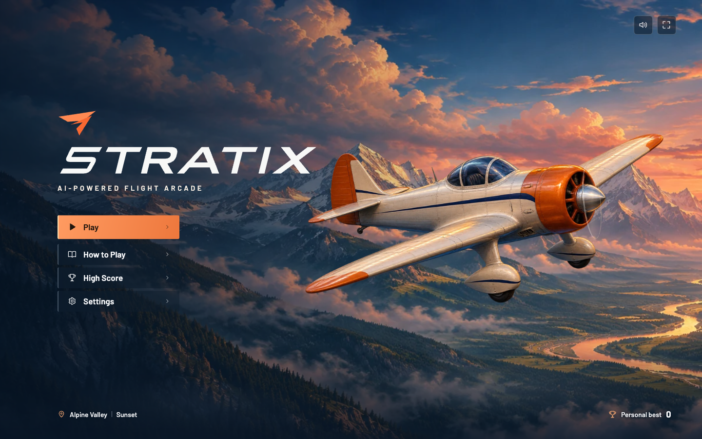
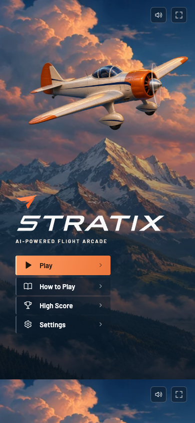

# STRATIX

**AI-Powered Flight Arcade** · Gün batımında Alp vadisi üzerinde uç, irtifanı koru ve sıcak hava balonlarının arasından geç. Tek elle oynayabilir veya klavye, fare ve dokunmatik ekranı kullanabilirsin.


*Tarayıcıdaki manuel uçuştan kaydedilmiş kısa oynanış döngüsü.*

## Mac’te oyna

[**STRATIX’i indir · macOS**](downloads/STRATIX-macOS.zip?raw=true)

ZIP’i açıp turuncu kanat simgeli **STRATIX** uygulamasına çift tıkla. İstersen uygulamayı **Uygulamalar** klasörüne taşıyabilirsin. Oyun ve el takip modeli pakete dahildir. macOS 13 veya üzeri, Intel ve Apple Silicon desteklenir. macOS, internetten indirilen bu sürüm için geliştirici doğrulaması isteyebilir.

## Kontroller

**Play** ile el kontrollü uçuşu başlat. Kamerasız oynamak için **Settings → Flight control → Manual** seç. Kamera izni reddedilirse **Fly manually** ile devam edebilirsin.

| Girdi | Uçuşta karşılığı |
| --- | --- |
| El | Avuç içini kameraya göster. Orta parmağını bükerek bir kez yüksel, yeniden yükselmek için önce doğrult. |
| Klavye | Her Space veya ↑ basışında bir kez yüksel. |
| Fare veya dokunma | Oyun alanına tıklayarak veya dokunarak yüksel. |
| Esc | Uçuşu duraklat veya devam ettir. |

Her uçuş saniyesi **1 puan**, geçilen her balon **10 puan** kazandırır. En iyi beş uçuş ve ses, kontrol, hareket tercihleri tarayıcıda saklanır.

## Kokpitten görünümler


<details>
<summary>Ana menü ve telefon görünümü</summary>





</details>

## Kamera ve gizlilik

El takibi cihazında çalışır. Kamera görüntüsü gösterilmez, kaydedilmez veya sunucuya gönderilmez. Sağ alttaki panel elinin algılanan 21 noktasını gösterir. El 1,2 saniye boyunca kaybolursa uçuş duraklar. Manuel kontrole geçtiğinde veya uçuş sona erdiğinde kamera kapanır.

## Kaynaktan çalıştırma

Node.js 22.18 veya üzeri ve npm ile proje klasöründe çalıştır.

```sh
npm install
npm run dev
```

Terminaldeki yerel adresi aç. Web sürümünde kamera erişimi için localhost veya HTTPS gerekir.

| Komut | İşlev |
| --- | --- |
| `npm test` | Uçuş fiziği ve el jesti testlerini çalıştırır. |
| `npm run build` | TypeScript denetimini yapar ve statik siteyi `dist/` içine derler. |
| `npm run preview` | Üretim sürümünü yerel tarayıcıda açmak için sunar. |
| `npm run build:mac` | macOS üzerinde Apple komut satırı geliştirme araçlarıyla uygulamayı ve indirilebilir ZIP’i yeniden üretir. |

Oyun TypeScript, Canvas 2D ve Web Audio kullanır. MediaPipe Hand Landmarker ayrı bir Web Worker içinde çalışır. Uçuş fiziği, ses ve el kontrolü kaynakları [src/](src/) dizinindedir.

## GitHub Pages

Paylaşmadan önce proje klasöründe `python3 scripts/check-publication.py` çalıştırabilirsin. Bu kontrol Git’e gidecek dosyaları ve uygulama ZIP’inin içeriğini yerel kimlik bilgileri ve yaygın anahtar biçimleri için tarar.

Depoda **Settings → Pages → Source → GitHub Actions** seç. **Actions → Deploy STRATIX to Pages → Run workflow** ile ilk yayını başlat. Sonraki `main` güncellemelerinde [iş akışı](.github/workflows/pages.yml) testleri çalıştırır ve web sürümünü yayımlar.
