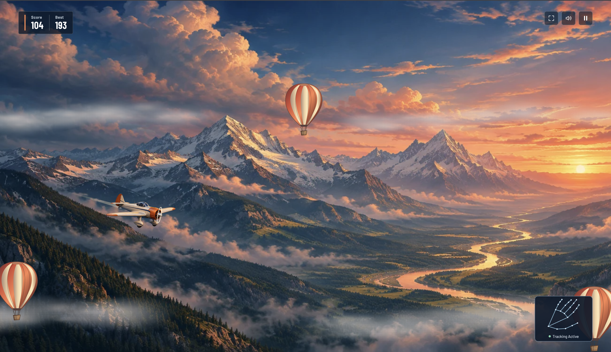
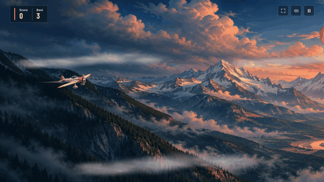

# STRATIX

<div align="center">

**AI-Powered Flight Arcade**

*A browser-based flight game with real-time, on-device hand tracking.*

**Developed by [Altan Ulaş Zöhre](https://github.com/altanulaszohre)**

</div>

## Overview

STRATIX is a 2D side-scrolling flight arcade game in which players navigate an aircraft through a mountain landscape and avoid airborne obstacles. Its primary interaction method uses computer vision to recognize hand gestures from a webcam and translate them into flight commands.

The game combines a lightweight rendering and physics system with on-device hand tracking. Players can also use a keyboard, mouse, or touch input, making the game accessible without a camera. STRATIX runs in a web browser and is also available as a packaged macOS application.

## Screenshots

<p align="center">
  
  
</p>

<p align="center"><sub>Gameplay and main menu</sub></p>

<p align="center">
  
</p>

<p align="center"><sub>Gameplay demonstration recorded using manual controls</sub></p>

## Features

- **Computer-vision controls:** Fly using webcam-based hand gesture recognition.
- **On-device processing:** Hand detection runs locally without displaying or uploading camera footage.
- **Alternative input methods:** Play using a keyboard, mouse, or touch screen.
- **Arcade flight mechanics:** Navigate obstacles with responsive flight physics and collision detection.
- **Dynamic presentation:** Layered mountain scenery, animated aircraft, and an integrated game interface.
- **Local progress:** Best runs and user preferences are saved on the device.
- **Cross-platform access:** Run in a modern web browser or use the packaged macOS version.

## How Hand Tracking Works

STRATIX uses **MediaPipe Hand Landmarker** to detect 21 hand landmarks from webcam frames. The landmark data is processed to identify a finger gesture, which the game converts into a flight input.

Bending the middle finger triggers an upward impulse; straightening it resets the gesture so another impulse can be triggered. This keeps the flight input discrete rather than continuously activating while a finger remains bent.

Hand landmark inference runs in a **Web Worker**, separate from the main rendering loop. During gameplay, a compact panel shows the detected hand skeleton—not the camera feed.

**Camera privacy:** Video footage is not displayed, recorded, or sent to a server. If hand tracking is lost for approximately 1.2 seconds, the flight pauses. Camera access is released when the session ends or manual control is selected.

## Controls

| Input | Action |
| --- | --- |
| **Hand gesture** | Show your palm to the camera; bend your middle finger to ascend, then straighten it before the next ascent. |
| **Space / ↑** | Apply an upward impulse. |
| **Mouse / touch** | Click or tap the game area to ascend. |
| **Esc** | Pause or resume the game. |

Choose **Play** to begin with hand tracking. To play without a webcam, open **Settings → Flight control → Manual**. If camera permission is denied, select **Fly manually**.

**Scoring:** Earn 1 point per second of flight and 10 points for each balloon passed. The five best runs and game preferences are stored locally.

## Technology

| Component | Technology |
| --- | --- |
| Language | TypeScript |
| Rendering | HTML5 Canvas 2D |
| Audio | Web Audio API |
| Hand tracking | MediaPipe Hand Landmarker |
| Inference execution | Web Worker |
| Web development and build | Node.js / npm |

The game separates flight physics, sound, and gesture control into modules under [`src/`](src/).

## Play and Installation

### Web browser

To run STRATIX locally, install **Node.js 22.18 or later** and npm:

```bash
git clone https://github.com/altanulaszohre/STRATIX.git
cd STRATIX
npm install
npm run dev
```

Open the local address shown in the terminal.

Webcam access requires **localhost** or a **secure HTTPS connection**, together with camera permission. Manual controls work without camera access.

### macOS

[Download STRATIX for macOS](downloads/STRATIX-macOS.zip?raw=true)

Extract the ZIP archive and open the **STRATIX** application. You can move it to the Applications folder.

The package includes the game and its hand-tracking model. It is intended for **macOS 13 or later**, on Intel and Apple Silicon Macs. As an independently distributed application, it may prompt a macOS developer-verification warning.

## Development

| Command | Description |
| --- | --- |
| `npm run dev` | Start the local development server. |
| `npm test` | Run flight physics and gesture-control tests. |
| `npm run build` | Type-check and produce the static build in `dist/`. |
| `npm run preview` | Preview the production build locally. |
| `npm run build:mac` | Build the macOS application and ZIP archive on macOS with Apple command-line developer tools. |

### GitHub Pages

The repository includes a [GitHub Pages deployment workflow](.github/workflows/pages.yml). To publish the browser version:

1. In the repository, open **Settings → Pages** and select **GitHub Actions** as the source.
2. Run **Actions → Deploy STRATIX to Pages** for the initial deployment.
3. Subsequent updates to `main` trigger the workflow, including tests and deployment.

Before publishing, the repository's `python3 scripts/check-publication.py` utility can be used to check tracked files and the macOS archive for common credential patterns.

## Author

**Altan Ulaş Zöhre**  
Computer Engineering  
[GitHub](https://github.com/altanulaszohre)

---

<sub>STRATIX · AI-Powered Flight Arcade</sub>
